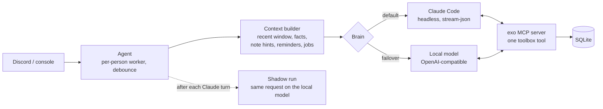

# exoskeleton

A lightweight homelab harness: one Go binary that turns Claude Code into a
personal assistant you message on Discord, with a local model as the fallback,
background jobs, schedules and a dashboard.

The idea is a **small context rebuilt every turn**. Agent gateways that keep a
rolling session resend the whole history on every call. The one this replaced
averaged ~128k tokens per call; one two-week chat made 384 calls and read 49M
cached tokens. exo stores everything in SQLite and gives the model only what
this turn needs: a few recent exchanges, matching facts and notes, and a
one-tool index of everything else.

## In production

I run it as Kiki on my home server (since 2026-10-08):

| | |
|---|---|
| Chat turns | 274, plus 78 background jobs |
| Fixed prompt cost | ~710 tokens of system prompt + ~290 for the toolbox (`exo budget`) |
| Shadow runs (local model vs. Claude on real turns) | 796 across 18 tuning revisions, 182 hand-graded |
| Note retrieval, MRR@5 on 26 real queries | 0.71 vector + filter vs. 0.40 keyword |

## How it works



- **Toolbox.** Chat turns see one tool whose description is a generated index
  (`branch: name(args) purpose`). The model calls `{tool, args}`, or `help` for
  one tool's full schema. Ten tools cost ~290 tokens instead of ~900.
- **Injection guard.** Web results are fenced as untrusted, and once a turn
  has read them, tools that act (shell, jobs, memory writes) refuse until the
  person confirms in their next message.
- **Shadow mode.** After each real Claude turn, the same request runs on the
  local model in the background with side effects stubbed. The dashboard
  shows both answers side by side with latency and tokens per variant, plus
  verdict buttons. Past turns can be replayed exactly as Claude saw them.
- **Guards for small models.** Unbacked "done" claims, broken tool-call JSON,
  thinking that eats the whole budget and tool calls leaked as text are each
  caught and retried (`engine/local.go`, revisions in `shadow.go`).
- **Failover.** A rate limit or auth failure holds messages and asks the admin
  "go local?". It probes Claude until it's back, then switches back on its own.
- **Background jobs** run as full Claude Code sessions in transient systemd
  units, so restarting exo doesn't kill them, and exo re-attaches on startup.
  Kits (`kits.json`) are specialist jobs that load only their own MCP server.
- **Routines and heartbeat.** The assistant can schedule its own recurring
  tasks, and an optional heartbeat reviews recent conversations, keeps an
  interests list and open loops, and messages only when something's worth it.
- **Per-person privacy.** Admins get server tools; everyone else gets chat,
  memory and reminders, and the dashboard shows their turns as metadata only.

## Quick start

Needs Go 1.27, Linux with systemd, and the Claude Code CLI logged in
(`claude setup-token`, or an API key).

```bash
go build -o /usr/local/bin/exo ./cmd/exo
sudo mkdir -p /etc/exo /var/lib/exo
sudo cp examples/exo.env.example /etc/exo/exo.env        # then fill it in
sudo cp examples/people.example.json /var/lib/exo/people.json
sudo cp deploy/exo.service /etc/systemd/system/ && sudo systemctl enable --now exo
```

It starts in dry run: replies are logged, not sent. Try it from the dashboard
console (`127.0.0.1:8656`), then set `EXO_DRY_RUN=0`. Prompts are editable on
the dashboard and versioned.

```bash
go test ./...
```

## Building on it

`cmd/exo` is a thin main over the `app` package. A deployment with its own
channels and tools imports the packages and adds to the app before running it:

```go
cfg, _ := config.LoadBrand(config.Brand{Prefix: "ACME", Slug: "acme"}) // ACME_* env, acme.db, mcp__acme__*
a, _ := app.New(cfg)
a.Agent.AddChannel(agent.Channel{Name: "sms", Sender: sms, Who: lookup, ChatFor: home})
a.Reg.Add(&tools.Tool{Name: "scores", Where: "both", Branch: "look", Short: "live scores", Run: scores})
a.AddBuiltin(sched.Entry{Name: "nightly-check", Cron: "10 4 * * *"}, check)
a.Web.Mount = func(mux *http.ServeMux) { mux.HandleFunc("GET /garden", page) }
a.Run(ctx)
```

My own assistant runs this way: the same core plus an iMessage channel,
Discord voice calls, a logged-in browsing agent, a server monitor with
service switches, and the prompts and tools specific to my setup.

## License

MIT
